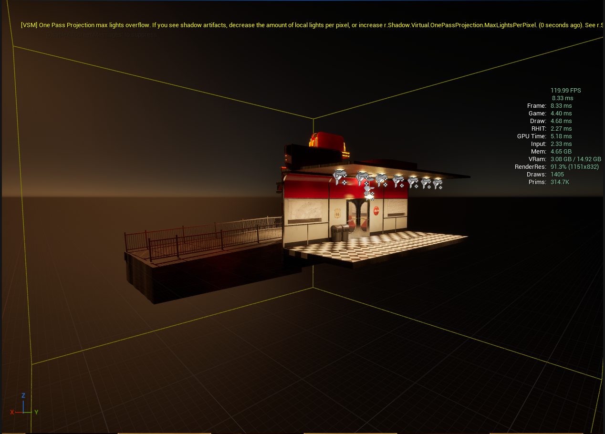
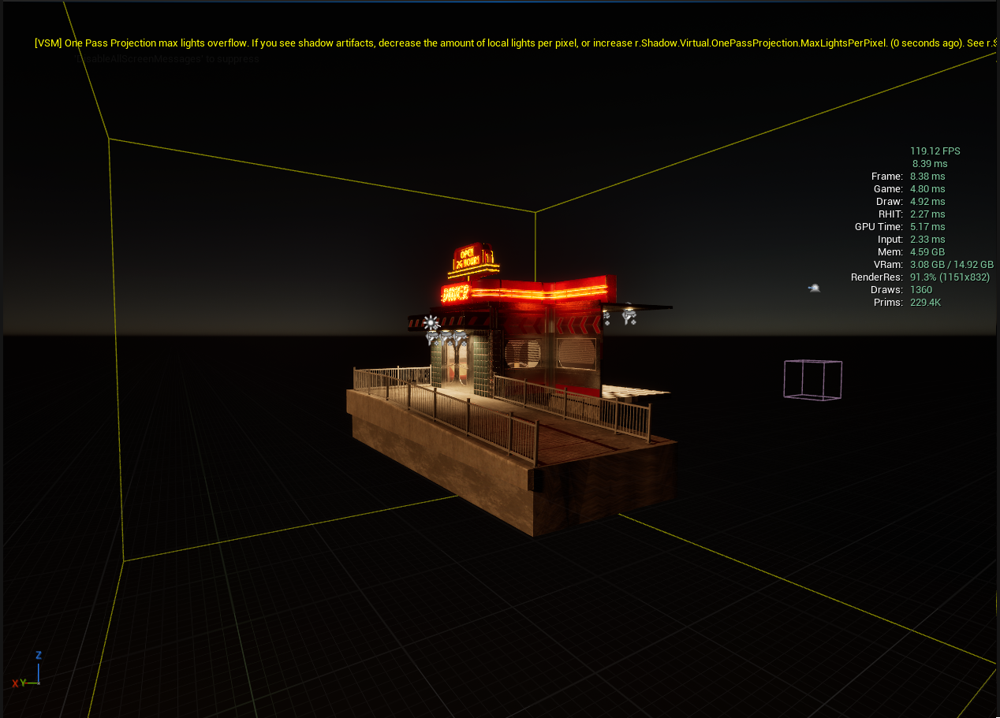
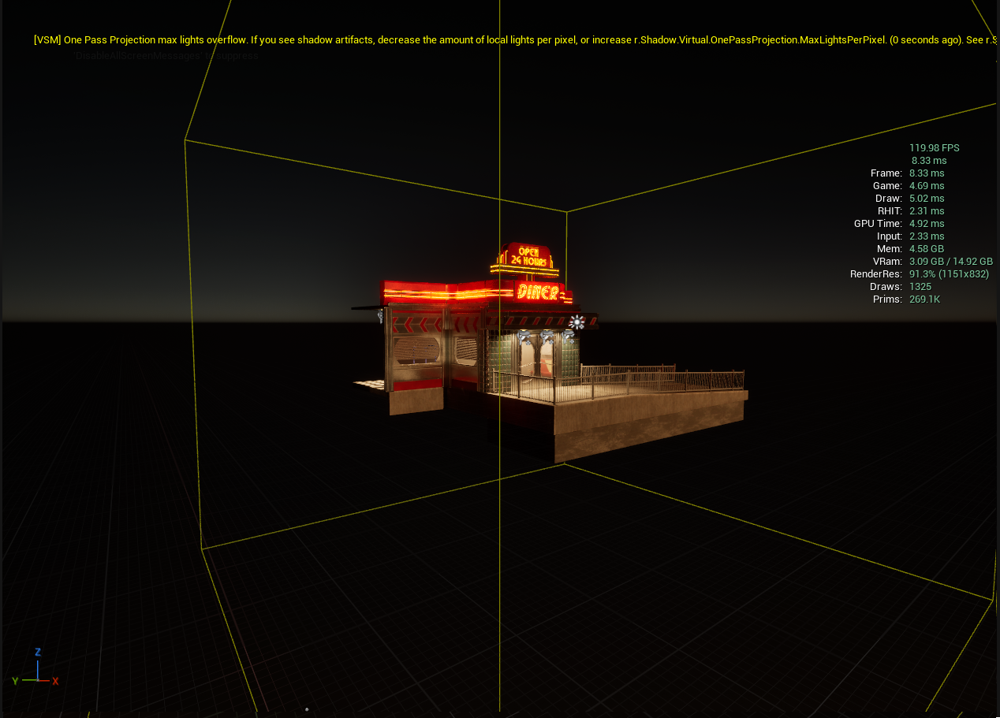
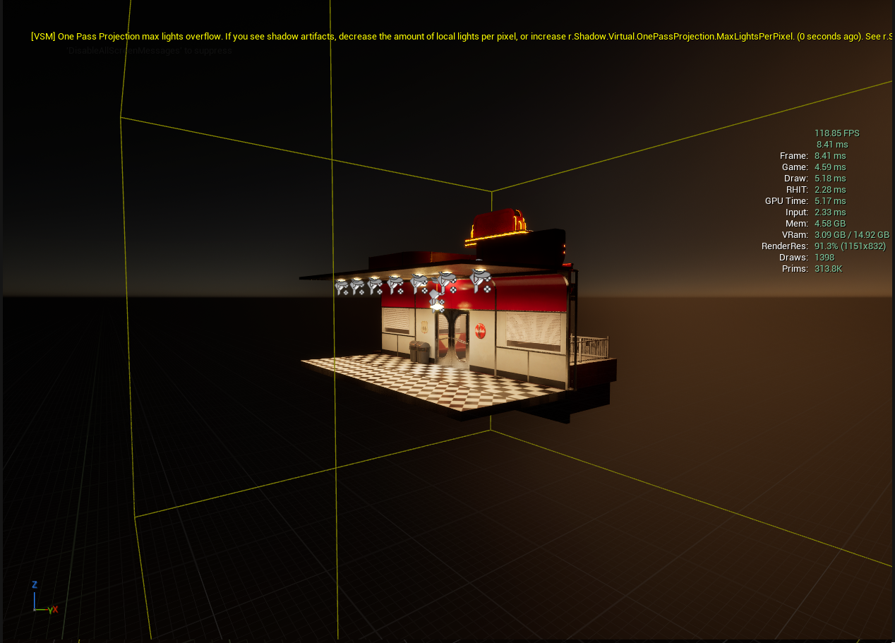
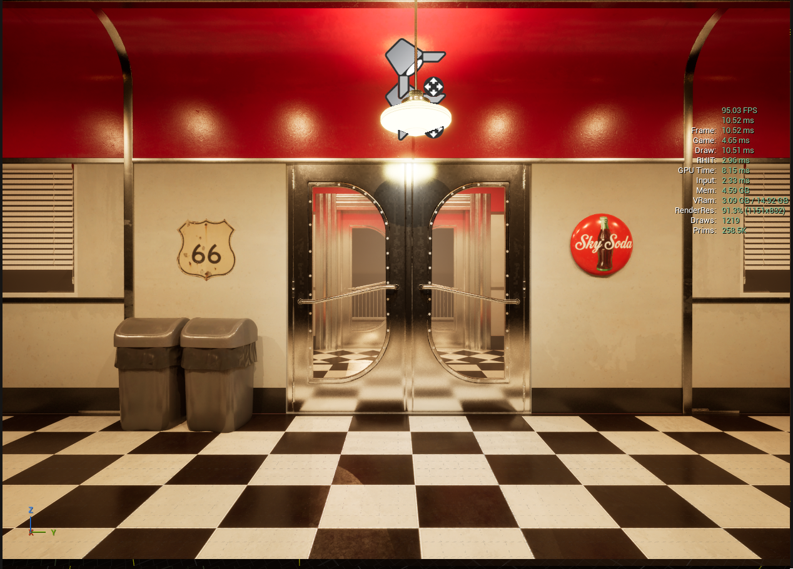
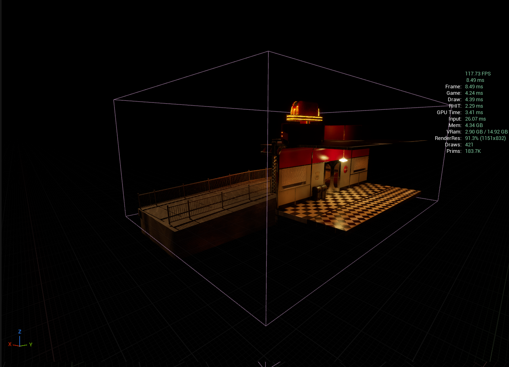
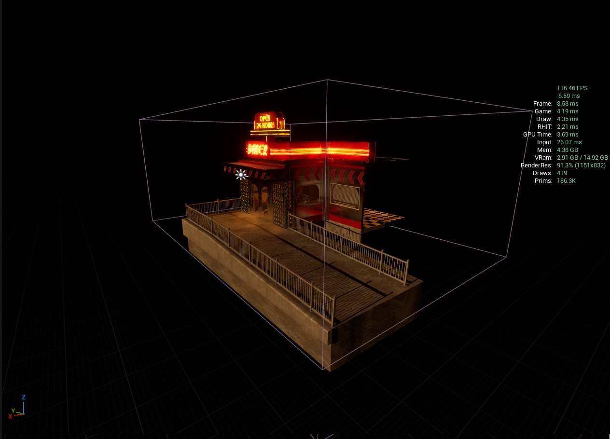
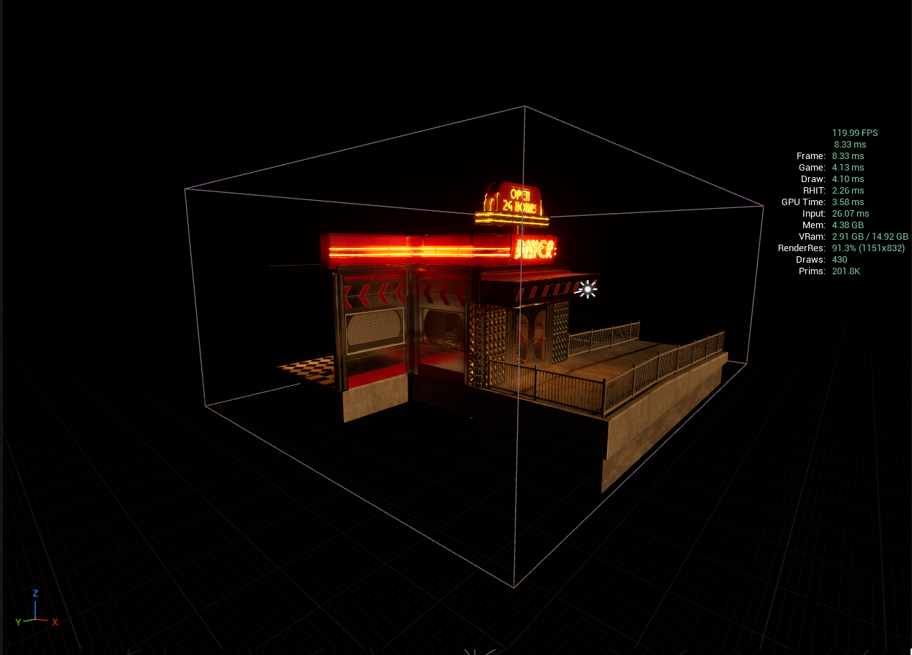
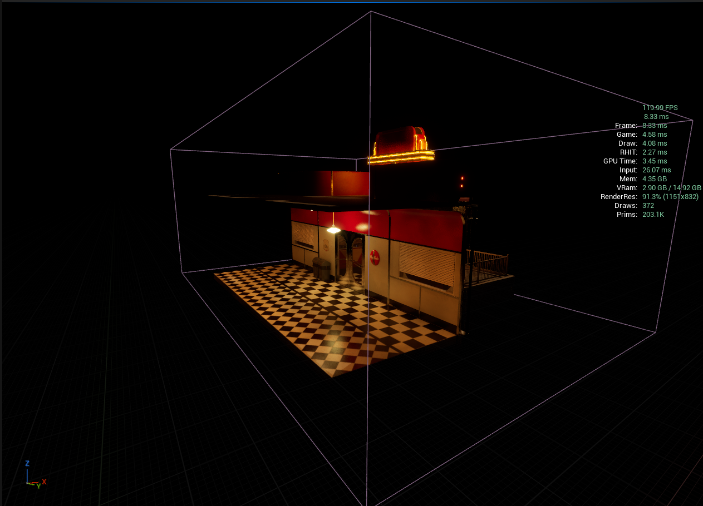
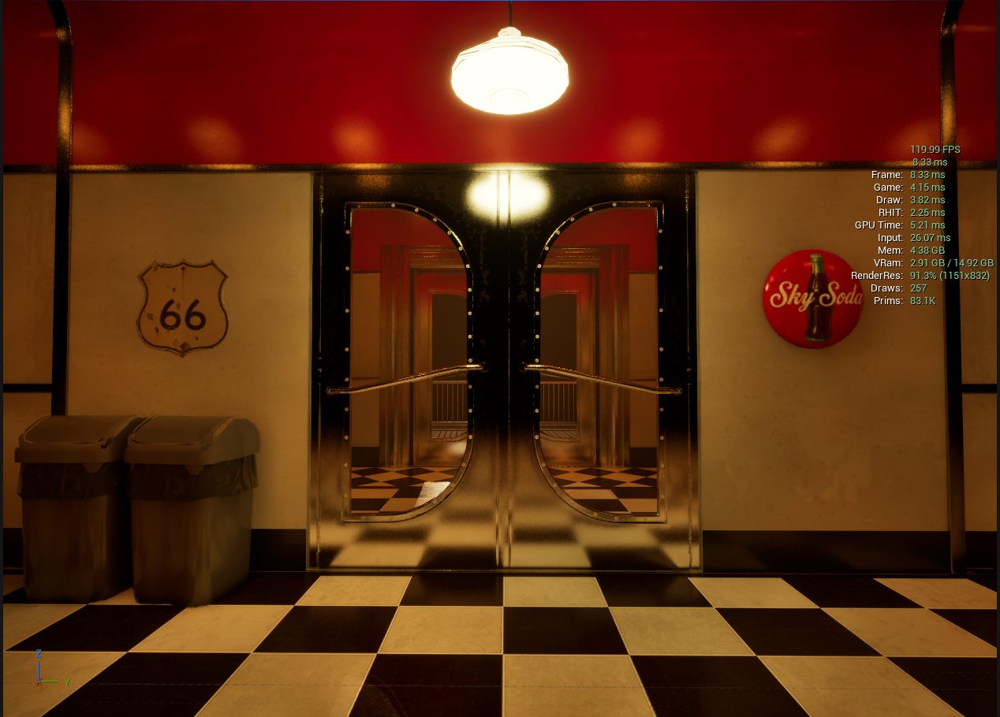

# Escenario Optimizado

FAB: https://www.fab.com/listings/df0308bb-f095-4a54-8544-5a893d91bd24

Nombre FAB: Free Sample - American Diner Environment / Restaurant / Cafe

## Métricas y capturas:
### Antes:  

### Después:

## Descripción:
He agrupado objetos en relación de si estaban cercanos o si pertenecían a una zona en concreto, por ejemplo, todo los objetos del interior sin incluir las paredes y el techo
He reducido la malla para dejarla al límite antes de que se vea mal (algunas un 50% otras un 25-30%)
He quitado ciertas iluminaciones, y las estáticas las he cambiado de móviles a estáticas, a excepción de la iluminación global que está en estacionaria
He reducido la calidad de todas las texturas a un LOD 2
